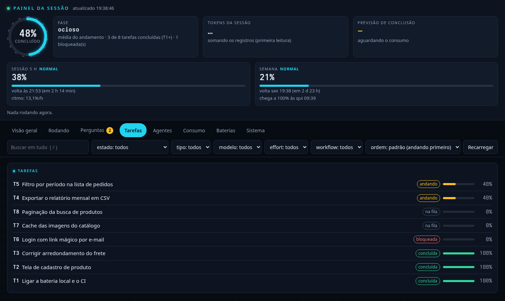
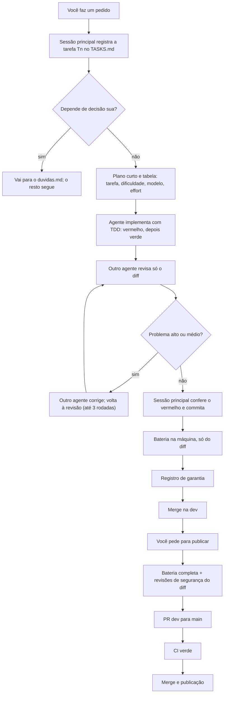

# OptimusClaude

**Um método para desenvolver software com o Claude Code: a sessão principal orquestra, subagentes fazem, e cada mudança é testada, revisada e registrada antes de seguir.**

[](LICENSE)


Você clona, roda um script e ganha: regras globais para o Claude, agentes e skills prontos, workflows de revisão, um
painel da sessão no navegador (com acesso pelo celular) e um **projeto modelo** com a bateria de testes, o CI e os
registros de garantia já montados. Funciona para qualquer linguagem.



<sub>O painel da sessão com um projeto de exemplo: cada tarefa com o seu estado e progresso, os limites de uso do Claude
e as perguntas esperando resposta (que também dá para responder pelo celular).</sub>

Nasceu do uso diário num sistema de produção com vários agentes de IA, banco, painel web e CI, e foi generalizado.

## Entenda do zero

Se você nunca viu o projeto, comece por aqui. Depois desta seção, o resto do README é referência.

### O que é, em uma frase

O Claude Code já sabe programar. O OptimusClaude dá a ele **um jeito de trabalhar**: regras do que fazer e em que
ordem, ajudantes especializados e ferramentas que provam que o trabalho foi feito, para você não ter de confiar no
"pronto" da IA.

Pense numa pequena equipe. Há um **coordenador** (a sessão principal do Claude, com quem você conversa). Ele não põe
a mão no código: entende o pedido, divide em tarefas e passa cada uma para um **executor** (um subagente). Outro
subagente faz o papel de **revisor** e tenta achar defeito no que o primeiro fez. No fim, o coordenador confere tudo
com **testes** e só então guarda o resultado no git. Você é o **cliente**: pede, decide o que só você pode decidir e
autoriza a publicação.

### As três partes do kit

| Parte | Onde fica depois de instalar | Para que serve |
|---|---|---|
| **Regras e ferramentas do Claude** (`claude/`) | `~/.claude`, valendo para todos os seus projetos | Ensinam o método ao Claude e trazem os agentes, skills e workflows que ele usa |
| **Painel da sessão** (`painel/`) | `~/painel-da-sessao` | Página no navegador (e no celular) que mostra o que a sessão está fazendo e deixa você responder perguntas de longe |
| **Projeto modelo** (`projeto-modelo/`) | Você copia para cada projeto novo | Esqueleto com tarefas, dúvidas, bateria de testes, CI e registros já ligados ao método |

### O fluxo, contado em prosa

1. **Você pede** algo em linguagem normal ("quero exportar o relatório em CSV").
2. **A sessão anota.** O pedido vira uma tarefa (`T1`, `T2`...) no `TASKS.md`, com as suas palavras, o que fazer e
   como conferir. Se falta uma decisão que só você pode tomar, ela vai para o `duvidas.md` e o trabalho que não depende
   dela segue. Se você não está no PC, chega um aviso no celular.
3. **A sessão planeja** e mostra uma tabela: cada tarefa, a dificuldade, o modelo (Haiku, Sonnet ou Opus) e o esforço.
   Tarefa difícil vai para o modelo mais forte; tarefa mecânica, para o mais barato. Você dá o ok.
4. **Um executor implementa com TDD.** Primeiro escreve o teste, roda e vê **falhar** (o "vermelho"). Só depois
   escreve o código e vê o teste **passar** (o "verde"). O teste que falha antes prova que ele testa algo de verdade.
5. **Outro agente revisa** só o que mudou (o diff) e devolve os problemas com arquivo, linha e gravidade. Se houver
   problema alto ou médio, um terceiro corrige e a revisão roda de novo, até 3 vezes.
6. **A sessão confere sozinha:** roda o teste novo contra o código antigo (tem de falhar), roda a bateria de testes
   do que mudou e faz o commit numa branch. Estando tudo verde, junta na `dev`.
7. **Fica um registro:** cada bateria, revisão e correção vira uma linha em `registros/`, com data, commit e sha256.
   Assim dá para provar depois o que foi testado.
8. **Só vai para produção quando você pedir.** Aí roda a bateria completa, as revisões de segurança, abre o PR da `dev`
   para a `main` e espera o CI do GitHub ficar verde.

Duas ideias atravessam tudo:

- **Quem faz não confere o próprio trabalho.** Executor, revisor e verificação final são sempre separados.
- **O que é bruto fica fora da conversa.** Logs, saídas de teste e arquivos grandes são lidos por subagentes ou
  ferramentas que devolvem só o resumo. A conversa principal fica curta, mais barata e mais precisa.

### Quem decide o quê

O Claude não precisa de você para tudo, mas também não decide tudo sozinho. A regra fica no `duvidas.md` do projeto
modelo.

| Tipo de decisão | Quem decide | Como |
|---|---|---|
| **Simples** (como implementar, onde pôr o código, como dividir o pedido, qual agente usar) | O Claude, sozinho | Anota o porquê na tarefa do `TASKS.md`, para você conferir depois |
| **Se ficou pronto** | Os testes e o agente revisor | Nem você nem a IA "achando" que terminou |
| **Difícil** (escolha de desenho importante) | Um conselho de modelos (skill `llm-council`), e você confirma | Entra no `duvidas.md` como "decidido pelo conselho, para confirmar" |
| **Permissão** (publicar, mexer em produção, apagar algo) | Sempre você | Nada disso acontece sem o seu OK |
| **O que só você sabe** (regra de negócio, prioridade, opções que mudam o produto) | Você | Vai para o `duvidas.md` com as opções e uma recomendação |
| **As decisões em aberto de cada pedido** | Você, numa entrevista | Todo pedido novo começa pela skill `grilling` (ou você chama `/grill-me`): o Claude pergunta em rodadas, sempre com a resposta que recomenda, até não sobrar decisão suposta. Pedido sem decisão sua (rodar testes, corrigir um typo) passa direto |

Uma pergunta para você não para o trabalho todo: só a tarefa que depende dela fica esperando, e o resto segue. Pergunta
urgente chega no celular (ntfy) e pode ser respondida pela aba Perguntas do painel. As outras você resolve de uma vez
quando voltar.

### Peça por peça

**Regras (`claude/CLAUDE.md` e `claude/RTK.md`).** É o "manual do funcionário" do Claude: o método inteiro escrito
como instrução. O Claude Code lê esses arquivos no começo de toda sessão.

**Agentes (`claude/agents/`).** Subagentes com o mínimo de ferramentas para a função. Menos ferramentas, menos tokens
gastos a cada chamada.

| Agente | Pode | Usado para |
|---|---|---|
| `runner` | só rodar comandos | rodar testes e scripts e resumir o resultado |
| `searcher` | só ler e buscar | achar onde algo está definido ou quem chama uma função |
| `editor` | ler e editar | aplicar uma mudança pequena e já definida num arquivo conhecido |
| `doc-writer` | ler e criar arquivo | escrever um arquivo novo do zero a partir de uma especificação |
| `researcher` | só web | consultar documentação externa, sem acesso aos seus arquivos |

**Skills (`claude/skills/`).** Instruções prontas que o Claude carrega quando a situação pede.

| Skill | O que faz |
|---|---|
| `preflight` | Antes de codar, confere se a solução já existe no projeto, na linguagem ou numa biblioteca instalada |
| `session-handoff` | No fim de uma sessão longa, guarda o que importa e escreve o resumo para a próxima sessão continuar |
| `notify` | Manda aviso para o celular (ntfy) quando você pede "me avisa quando terminar" |
| `painel` | Liga o painel da sessão para o projeto atual (`/painel`) |
| `snote` | Salva o resumo da conversa como nota no seu vault do Obsidian (`/snote`) |

**Workflows (`claude/workflows/`).** Roteiros com vários agentes, para trabalho maior.

- `fazer-revisar-corrigir.js`: recebe um lote de tarefas já especificadas. Para cada uma, um agente faz, outro revisa
  e outro corrige, em paralelo, cada tarefa no seu worktree.
- `revisao-profunda.js`: revisão pesada antes de publicar. Um revisor por dimensão (correção, segurança, concorrência,
  dados, testes e, se pedir, LGPD), e cada achado é testado por "céticos" que tentam derrubá-lo. Só lê, não muda nada.

**Comando `/stop` (`claude/commands/`).** Para na hora o que estiver em andamento.

**Mods (`claude/mods/`).** Mudam a interface do Claude Code: `status-bar` (linha de status com git, modelo,
contexto, limites de uso e consumo dos subagentes) e `painel-agentes` (painel lateral com os agentes rodando).

**Scripts (`claude/scripts/`).** `install_skills.py` instala pacotes de skills de um repositório git,
`plugin_audit.py` mostra quanto cada plugin ligado custa em tokens por sessão, e `vault_search.py` faz busca compacta
no vault do Obsidian.

**Painel (`painel/`).** Servidor local em Python, só com a biblioteca padrão. Mostra tarefas, agentes, baterias de
teste, worktrees, consumo de tokens e limites de 5 h e da semana. A aba Perguntas deixa você responder pelo celular
o que a sessão está esperando. Os testes dele rodam com `python3 testar.py`, que escolhe só os ligados ao que mudou.

**Projeto modelo (`projeto-modelo/`).**

| Arquivo | Para que serve |
|---|---|
| `CLAUDE.md` | O que o seu projeto é e o que não é; os comandos de teste dele |
| `BOAS-PRATICAS.md` | As regras de código do projeto |
| `TASKS.md` | A fila de tarefas `Tn`, com estado de cada uma |
| `duvidas.md` | O que espera decisão sua |
| `scripts/testar-como-o-ci.sh` e `scripts/o_que_testar.py` | A bateria: roda na máquina o que o CI rodaria, só para o que o diff toca |
| `registros/` | As provas: baterias, revisões, correções e publicações pendentes |
| `.github/workflows/testes.yml` | O CI, que roda só no PR para a `main` e no push da `main` |
| `.claude/skills/` | `publicar` (da `dev` até a produção), `aplicar-migration` (mudança de banco testada com rollback) e `conferir-producao` (ver se a produção está saudável) |

### Glossário rápido

| Termo | Quer dizer |
|---|---|
| **Sessão principal** | A conversa com o Claude que você abre. Coordena e confere; não escreve código |
| **Subagente** | Outra instância do Claude que a sessão dispara para uma tarefa e que devolve só o resumo |
| **Modelo e effort** | Qual Claude (Haiku, Sonnet, Opus) e quanto ele pensa. Escolhidos pela dificuldade da tarefa |
| **TDD, vermelho e verde** | Teste antes do código. Vermelho: o teste falha sem a mudança. Verde: passa com ela |
| **Diff** | O que mudou em relação à versão anterior |
| **Bateria** | O conjunto de verificações (testes, lint, tipos, segredos) que roda antes de juntar |
| **`dev` e `main`** | `dev` recebe o trabalho do dia a dia, testado na máquina. `main` é o que vai para produção, só por PR |
| **Worktree** | Uma segunda pasta do mesmo repositório, para dois agentes trabalharem sem pisar um no outro |
| **Registro de garantia** | A linha em `registros/` que prova que algo foi testado ou revisado, com commit e sha256 |
| **Skill** | Um pacote de instruções que o Claude carrega quando a situação pede |
| **MCP** | Protocolo para ligar ferramentas externas ao Claude (por exemplo a Serena, que navega o código por símbolo) |

## Por que existe

Quem usa IA para programar esbarra sempre nos mesmos problemas. O método ataca cada um com uma regra concreta.

| Problema | Como o método resolve |
|---|---|
| A conversa fica enorme, o contexto estoura e a qualidade cai | A sessão principal só decide e confere. Código, testes e textos longos vão para subagentes, que devolvem um resumo curto. Uma sessão nova a cada fase, com handoff pronto |
| A IA diz "pronto" sem ter testado | TDD obrigatório: o teste nasce primeiro e tem de **falhar** antes da correção. A sessão principal confere o vermelho rodando o teste novo contra o código antigo |
| Ninguém revisa de verdade | Quem faz não revisa. Outro agente lê o diff e devolve problemas com `arquivo:linha` e gravidade; um terceiro corrige. Até 3 rodadas |
| Gasto alto de tokens e de minutos de CI | Ferramentas que cortam a saída bruta (rtk, caveman, context-mode, Serena, ccc). Testes rodam na máquina, só do que o diff toca. O CI no GitHub roda só no PR para a `main` |
| Pergunta trava o trabalho quando você não está no PC | A tarefa que depende de você vai para o `duvidas.md` e o resto segue. Perguntas urgentes chegam no celular (ntfy) e se respondem pela aba Perguntas do painel |
| Nada prova que se testou e corrigiu | Toda bateria, revisão e correção vira um registro com data, commit e sha256 |
| Mudança vai para produção sem ninguém pedir | `main` protegida, só por PR vindo da `dev`. Publicar só com o seu pedido |

## Como funciona



Detalhe de cada passo: [docs/fluxo-de-trabalho.md](docs/fluxo-de-trabalho.md).

### Quem faz o quê, e com qual modelo

| Papel | Faz |
|---|---|
| **Você** | Pede, decide, responde as dúvidas, manda publicar |
| **Sessão principal** (o melhor modelo) | Conversa, repartição do trabalho, `TASKS.md`, commit e merge, verificação final. Não escreve código |
| **Agente que faz** | Código, testes, documentos, pesquisa. Não roda `git` |
| **Agente que revisa** | Lê o diff e tenta derrubar. Nunca é o mesmo que fez |

O modelo de cada agente é escolhido **pela dificuldade que sobra de decidir**, não pela área, e o effort nunca é `low`:

| Modelo | Quando |
|---|---|
| **Haiku** | Tarefa sem decisão: rodar um comando e resumir, aplicar patch já escrito, renomear |
| **Sonnet** | O padrão: implementar e corrigir com especificação clara, revisar diff comum |
| **Opus** | Raciocínio difícil: desenho em aberto, concorrência, causa desconhecida, segunda tentativa de algo que travou |

Detalhe: [docs/agentes-e-modelos.md](docs/agentes-e-modelos.md).

## O que vem no repositório

```
OptimusClaude/
├── install.sh          instala tudo (claude/ vai para ~/.claude, painel/ para ~/painel-da-sessao) e checa dependências
├── install.ps1         o mesmo no Windows nativo, menos o painel (que precisa de Linux; no WSL use o install.sh)
├── claude/             vai para ~/.claude
│   ├── CLAUDE.md       regras globais: o método, escrito como instrução ao Claude
│   ├── RTK.md          instruções do rtk, importadas pelo CLAUDE.md
│   ├── agents/         runner, searcher, editor, researcher, doc-writer (cada um com o mínimo de tools)
│   ├── skills/         notify, painel, preflight, session-handoff, snote
│   ├── workflows/      fazer-revisar-corrigir.js, revisao-profunda.js
│   ├── commands/       /stop
│   ├── mods/           status-bar e painel-agentes (plugins locais de interface)
│   ├── scripts/        instalar skills, medir o custo dos plugins, busca no vault
│   ├── statusline/     linha de status avulsa
│   └── settings.example.json
├── painel/             painel web local da sessão (Python, só biblioteca padrão)
├── projeto-modelo/     para copiar para o seu projeto: CLAUDE.md, BOAS-PRATICAS.md, TASKS.md, duvidas.md,
│                       scripts/ (bateria e mapa de testes), registros/, CI, skills publicar,
│                       aplicar-migration e conferir-producao
└── docs/               o método explicado
```

## Instalação rápida

**Pré-requisitos:** [Claude Code](https://docs.claude.com/en/docs/claude-code), `git`, `python3`, Node.js e
[uv](https://docs.astral.sh/uv/). Recomendados: `gh`, `jq`, `curl`, `gitleaks`. Opcional: `semgrep`. O `install.sh` diz o
que falta. Lista completa em [docs/dependencias.md](docs/dependencias.md).

```bash
git clone <url-do-repositorio> OptimusClaude
cd OptimusClaude
./install.sh --dry-run     # mostra o que faria, sem mudar nada
./install.sh               # instala
```

**O que o `install.sh` faz:**

- Copia `claude/` para `~/.claude` e `painel/` para `~/painel-da-sessao`. Se o arquivo de destino já existe e é
  diferente, guarda o antigo em `~/.claude/backups/optimusclaude-<data>/`.
- Se não existe `~/.claude/settings.json`, cria um a partir do exemplo (com `<placeholders>` para você trocar).
- Checa as dependências. Instala sozinho o que tem instalador seguro (caveman por `npm`; Serena, ccc e semgrep por
  `uv tool`), registra o MCP da Serena, os marketplaces e os plugins do Claude Code e os dois mods de interface do
  repositório.
- Lista no fim o que ficou para você fazer. Rodar de novo só refaz o que mudou.

**O que ele não faz:**

- Não sobrescreve um `settings.json` que já existe. Para mesclar o exemplo no seu: `./install.sh --mesclar-settings`
  (precisa de `jq`, mostra a diferença e pede confirmação; o que é seu vence).
- Não instala o `rtk` nem o Claude Code: diz como.
- Não traz as skills de terceiros (`caveman`, `find-skills` e outras): veja [docs/dependencias.md](docs/dependencias.md).

**Outras opções:** `--so-checar` (não instala dependência nem plugin, não grava nada: só diz o que falta e quais arquivos seriam copiados),
`--sem-plugins` (pula marketplaces e plugins), `--help`.

Abra uma sessão nova do Claude Code depois de instalar.

### No Windows

Há dois caminhos. A diferença é só o painel da sessão, que lê informações do sistema que só o Linux oferece (`/proc`,
`ps`, `ip`).

| | Windows nativo (`install.ps1`) | WSL (`install.sh`) |
|---|---|---|
| Regras, agentes, skills, workflows, mods | sim | sim |
| Linha de status (contexto, limites, branch) | sim, a avulsa | sim, a do painel |
| Painel da sessão e perguntas pelo celular | não | sim |
| Quando escolher | Você usa o Claude Code direto no Windows e não precisa do painel | Você quer o kit completo |

**Windows nativo.** Abra o PowerShell na pasta do repositório:

```powershell
git clone <url-do-repositorio> OptimusClaude
cd OptimusClaude
powershell -ExecutionPolicy Bypass -File .\install.ps1 -DryRun   # mostra o que faria, sem mudar nada
powershell -ExecutionPolicy Bypass -File .\install.ps1           # instala
```

Ele faz o mesmo que o `install.sh`, com três diferenças:

- copia `claude\` para `%USERPROFILE%\.claude` e não instala o painel;
- se criar o `settings.json`, aponta a linha de status para a avulsa (`~\.claude\statusline\statusline.py`) e chama o
  Python de `python`;
- para o que falta, sugere o comando do `winget` (`winget install Git.Git`, `astral-sh.uv`, `GitHub.cli` e outros).

O `-ExecutionPolicy Bypass` libera só esta execução, porque o Windows bloqueia scripts baixados por padrão. Opções:
`-DryRun`, `-SoChecar` (só confere e não grava nada) e `-SemPlugins`. O Claude Code no Windows usa o Git Bash, que
vem junto com o Git for Windows.

**WSL (kit completo).** O WSL roda um Linux de verdade dentro do Windows. É o caminho recomendado se você quer o painel.

1. No PowerShell como administrador: `wsl --install` (instala o Ubuntu) e reinicie.
2. Abra o Ubuntu pelo menu Iniciar e instale o Claude Code e as dependências dentro dele.
3. Clone o repositório **dentro do Linux** (em `~`, não em `/mnt/c/...`, que é bem mais lento) e rode `./install.sh`.
4. O painel abre no navegador do Windows em `http://127.0.0.1:8765`: o WSL repassa a porta sozinho.

O instalador nativo foi testado com o PowerShell 7 no Linux (cópia, backup, `-DryRun`, `-SoChecar`, nada mudando
na segunda rodada e a checagem de plugins igual à do `install.sh`). Ainda não foi testado num Windows de verdade: se
algo falhar, abra uma issue com a saída.

### Abrir o painel

Dentro do Claude Code, na pasta do seu projeto:

```
/painel
```

Ele sobe o servidor local e mostra o endereço no PC (`http://127.0.0.1:8765`) e o link com chave para abrir no celular,
na mesma rede. Detalhes em [painel/README.md](painel/README.md).

### Aviso no celular (ntfy)

1. Instale o app [ntfy](https://ntfy.sh) no celular.
2. No `env` do `~/.claude/settings.json`, defina `NTFY_TOPICO` (avisos gerais) e `NTFY_TOPICO_PERGUNTA` (aviso antes de
   uma pergunta que trava o trabalho). Assine os dois tópicos no app.
3. **O tópico é público pelo nome.** Quem souber o nome lê as mensagens. Use um sufixo aleatório
   (`python3 -c 'import secrets; print(secrets.token_hex(4))'`) e mande só o assunto curto, nunca dado de cliente,
   senha ou código. Sem `NTFY_TOPICO_PERGUNTA`, o Claude pula o aviso e pergunta direto.

## Começar um projeto

```bash
cp -r ~/caminho/para/OptimusClaude/projeto-modelo/. ~/meu-projeto/
cd ~/meu-projeto
git init -b main && git add -A && git commit -m "chore: projeto a partir do modelo"
git checkout -b dev
python3 -I -m unittest discover -s scripts -p 'test_*.py'   # os scripts do modelo se testam
scripts/testar-como-o-ci.sh                                 # a bateria, só do que mudou
ccc init && ccc index                                        # busca semântica no código
```

Depois:

1. Preencha o `CLAUDE.md` (o que o projeto é e o que **não** é) e ajuste o `BOAS-PRATICAS.md`.
2. Acrescente as verificações da sua linguagem em `scripts/o_que_testar.py` ([docs/linguagens.md](docs/linguagens.md)).
   Máquina e CI usam o mesmo mapa.
3. No GitHub, proteja a `main` (só por PR, check `tudo-verde` obrigatório, sem bypass para administrador) e fixe as
   actions do `.github/workflows/testes.yml` por SHA.
4. Apague as tarefas de exemplo do `TASKS.md` e do `duvidas.md`.

### O primeiro ciclo, na prática

1. Você escreve: "preciso baixar o relatório do mês em CSV". A sessão registra a `T1` no `TASKS.md` com as suas
   palavras, o que fazer e como conferir.
2. Ela mostra a tabela tarefa, dificuldade, modelo e effort. Você dá o ok.
3. Cria a branch `feat/relatorio-csv` a partir da `dev`. Um agente escreve o teste, vê falhar, implementa e vê passar.
4. Outro agente revisa o diff e devolve os problemas. Um terceiro corrige o que for alto ou médio.
5. A sessão principal roda o teste novo contra o código antigo (tem de falhar), commita, roda
   `scripts/testar-como-o-ci.sh` e, estando verde, faz `merge --no-ff` na `dev` e push.
6. `TASKS.md` e `registros/` ficam em dia. A `T1` passa para "feita na dev". Nada foi para produção: isso só acontece
   quando você pedir para publicar.

## Linguagens e ferramentas

O fluxo não depende de linguagem. Depende de cada uma ter um executor de teste, um linter e (quando existe) um
verificador de tipos que rodem por linha de comando.

| Linguagem | Teste | Lint e tipos |
|---|---|---|
| Python | `pytest` | `ruff`, `mypy` ou `pyright` |
| TypeScript e JavaScript | `vitest`, Playwright (tela) | `eslint`, `tsc` |
| SQL e PostgreSQL | testes em transação que se desfaz | verificador do banco |
| Bash | `bats` ou teste em Python | `shellcheck` |
| PowerShell, Deno, Docker, GitHub Actions | `Pester`, `deno test`, build da imagem | `PSScriptAnalyzer`, `deno lint`, `hadolint`, `actionlint` |
| Go, Rust, Java, C#, Ruby, PHP | exemplos de linha para o mapa | ver o doc |

Tabela completa e como acrescentar outra: [docs/linguagens.md](docs/linguagens.md).

## Economia de tokens

Tudo o que entra na conversa é relido a cada resposta. A regra: **o que é bruto fica fora do contexto; entra só a
resposta.**

| Ferramenta | O que faz |
|---|---|
| **rtk** | Proxy de shell, por hook: filtra a saída de `git`, testes, `grep` e outros |
| **caveman** | Respostas curtas e encolhimento de saída grande |
| **context-mode** | Processa saída grande num sandbox e devolve só o resultado |
| **Serena** | Navega e edita por símbolo (definição, quem chama), sem ler o arquivo inteiro |
| **ccc** | Busca semântica no código |

Mais: [docs/economia-de-tokens.md](docs/economia-de-tokens.md).

## Segurança

**O que o método garante (como regra de trabalho):**

- Quem decide acesso é o servidor e o banco, nunca a tela nem o modelo de IA.
- Segredo fora do repositório, com `gitleaks` na bateria e no CI; dado pessoal fora de log, commit e notificação.
- A IA é tratada como usuário não confiável: a barreira é o código, não o prompt.
- Antes de publicar, revisões de segurança do diff (`/security-review`, Claude Security, `semgrep`,
  `insecure-defaults`). Achado confirmado bloqueia a publicação.
- `main` protegida: só entra por PR, com CI verde, sem contornar a proteção.

**O que não garante:**

- São regras e checagens, não certificação. Quem as segue é o Claude (por instrução) e o CI; nada impede que uma
  instrução seja ignorada ou que um revisor, humano ou IA, deixe passar algo.
- Não substitui auditoria de segurança nem análise jurídica (LGPD e afins).
- O painel é HTTP sem TLS: use em rede local de confiança.
- O tópico do ntfy é público pelo nome.

Detalhes: [docs/seguranca.md](docs/seguranca.md).

## Documentação

| Documento | Do que trata |
|---|---|
| [Fluxo de trabalho](docs/fluxo-de-trabalho.md) | Do pedido à produção: tarefas, branches, worktrees, fazer-revisar-corrigir, bateria, publicação |
| [Agentes e modelos](docs/agentes-e-modelos.md) | Quem faz o quê; modelo e effort pela dificuldade; tipos de agente; brief em JSON |
| [Economia de tokens](docs/economia-de-tokens.md) | rtk, caveman, context-mode, Serena, ccc e os hábitos de leitura |
| [Testes e qualidade](docs/testes-e-qualidade.md) | TDD (inclusive SQL), testar como o CI pelo diff, telas, registros de garantia |
| [Segurança](docs/seguranca.md) | Segredos, menor privilégio, IA como usuário não confiável, dado pessoal, `main` protegida |
| [Arquitetura](docs/arquitetura.md) | Monorepo, fonte única, migrations, fila no Postgres, idempotência |
| [Estilo](docs/estilo.md) | Commits convencionais, sem coautoria de IA, nomes, mudanças pequenas |
| [Linguagens](docs/linguagens.md) | Ferramentas por linguagem e como acrescentar outra |
| [Dependências](docs/dependencias.md) | Tudo o que o método usa, de onde vem e como instalar |
| [Painel](painel/README.md) | O painel da sessão, a aba Perguntas e a configuração |
| [Mods](claude/mods/README.md) | Plugins locais de interface (linha de status e painel de agentes) |

## FAQ

**Funciona sem o painel?** O método não depende dele. Sem o painel você perde a visão da sessão e a aba Perguntas;
a skill `notify` e o `duvidas.md` continuam valendo. O `settings.example.json` aponta a linha de status para a do
painel; para usar a avulsa, veja [docs/dependencias.md](docs/dependencias.md). Não foi testado rodar o fluxo inteiro
sem o painel instalado.

**Funciona sem os plugins?** O `install.sh --sem-plugins` pula a instalação deles. Mas o `superpowers` (TDD, verificação
antes de concluir, depuração) é tratado como obrigatório em [docs/dependencias.md](docs/dependencias.md), e as regras
do `CLAUDE.md` contam com ele. Não foi testado sem eles.

**Funciona no Windows ou no macOS?** No Windows, sim: o `install.ps1` instala tudo menos o painel, e pelo WSL o
`install.sh` instala o kit completo (veja [No Windows](#no-windows)). O método foi escrito e usado em Linux; o
`install.ps1` ainda não foi testado num Windows de verdade, e o macOS não foi testado.

**Funciona com outro modelo que não seja da Anthropic?** Não. O método é feito para o Claude Code e para a escolha entre
Haiku, Sonnet e Opus. Outros modelos e outras ferramentas não foram testados.

**Quanto custa?** Este repositório é só configuração e scripts. O custo é o do seu plano ou da sua chave do Claude
Code, e não há medição dele aqui. O método tenta gastar menos com saída cortada, modelo mais barato quando a
tarefa permite e testes só do diff; em contrapartida, vários agentes e as revisões de segurança por IA consomem
licença, e os workflows multiagente gastam bem mais que agentes comuns (o próprio método manda avisar antes de rodá-los).

**Posso adotar só uma parte?** Dá para copiar só o `claude/CLAUDE.md`, os agentes ou o `projeto-modelo/`. Adotar partes
isoladas não foi testado; as regras se referem umas às outras.

## Créditos

Este repositório é cola e método. O trabalho pesado é de projetos de terceiros, cada um com a sua licença:

- [rtk](https://github.com/rtk-ai/rtk): proxy de shell que corta a saída dos comandos.
- [caveman](https://www.npmjs.com/package/@caveman-ai/cli) (`@caveman-ai/cli`): respostas curtas e encolhimento de saída.
- [context-mode](https://github.com/mksglu/context-mode): sandbox e índice para saídas grandes.
- [Serena](https://github.com/oraios/serena): navegação e edição por símbolo via LSP.
- [cocoindex-code](https://github.com/cocoindex-io/cocoindex-code) (`ccc`): busca semântica no código.
- [Plugins oficiais do Claude Code](https://github.com/anthropics/claude-plugins-official): superpowers, claude-security,
  security-guidance e outros.
- [ponytail](https://github.com/DietrichGebert/ponytail): modo "dev sênior preguiçoso".
- [Trail of Bits skills](https://github.com/trailofbits/skills): `insecure-defaults`.
- [mattpocock/skills](https://github.com/mattpocock/skills): `grill-me` e `grilling`, a entrevista que fecha as decisões
  em aberto.
- [uv](https://docs.astral.sh/uv/), [gitleaks](https://github.com/gitleaks/gitleaks),
  [semgrep](https://semgrep.dev), [GitHub CLI](https://cli.github.com) e [ntfy](https://ntfy.sh).

Lista completa, fontes e como instalar cada uma: [docs/dependencias.md](docs/dependencias.md).

## Contribuir

Issues e pull requests são bem-vindos. Mudança pequena e com teste; o painel tem testes
(`python3 testar.py` dentro de `painel/` roda só os ligados ao que mudou; `--tudo` roda todos). Texto em português do Brasil, commits no formato
`tipo(escopo): descrição`.

## Licença

[MIT](LICENSE): use, copie, modifique e distribua à vontade, mantendo o aviso de copyright. Sem garantia. As
ferramentas de terceiros listadas acima têm as licenças delas.

---

## In English

OptimusClaude is a working method for software development with Claude Code, shipped as an installable kit. The main
session only orchestrates; subagents do the work, each with the model and effort its difficulty calls for. Every change
goes through TDD (the test must fail first), an independent diff review and a fix round, and tests run locally, only on
what the diff touches. Test, review and fix runs are logged as verifiable records, and nothing reaches `main` without an
explicit request. The kit includes global rules, agents, skills, workflows, a local session dashboard with phone access,
and a project template with CI. Install with `./install.sh --dry-run`, then `./install.sh` (on Windows,
`install.ps1` installs everything except the dashboard, or use `install.sh` inside WSL for the full kit). Docs and instructions are in
Brazilian Portuguese. Linux is the tested platform. Licensed under [MIT](LICENSE).
