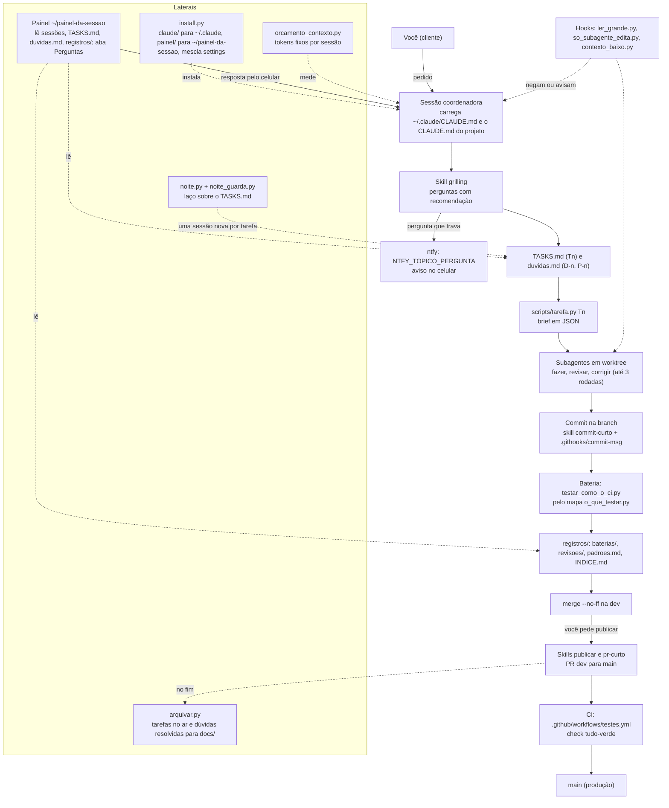
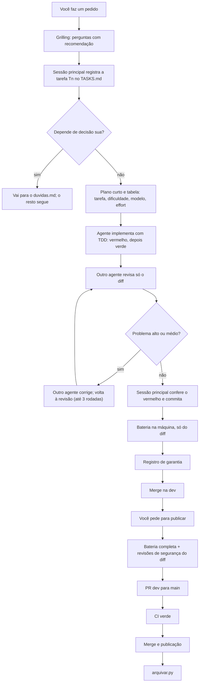

# OptimusClaude

**Um método para desenvolver software com o Claude Code: a sessão principal orquestra, subagentes fazem, e cada mudança é testada, revisada e registrada antes de seguir.**

[](LICENSE)


[English](README.en.md) · [Instalar](#instalar-em-1-minuto) · [Documentação](#documentação)

Você clona, roda um script e ganha: regras globais para o Claude, agentes e skills prontos, workflows de revisão, um
painel da sessão no navegador (com acesso pelo celular) e um **projeto modelo** com a bateria de testes, o CI e os
registros de garantia já montados. Funciona para qualquer linguagem.


<sub>O painel da sessão com um projeto de exemplo: cada tarefa com o seu estado e progresso, os limites de uso do Claude
e as perguntas esperando resposta (que também dá para responder pelo celular).</sub>

Nasceu do uso diário num sistema de produção com vários agentes de IA, banco, painel web e CI, e foi generalizado.

## Índice

1. [Instalar em 1 minuto](#instalar-em-1-minuto)
2. [Entenda do zero](#entenda-do-zero)
3. [Como tudo se conecta](#como-tudo-se-conecta)
4. [Cada peça](#cada-peça)
5. [Um pedido do começo ao fim](#um-pedido-do-começo-ao-fim)
6. [Quem decide o quê](#quem-decide-o-quê)
7. [Modo noturno](#modo-noturno)
8. [Economia de tokens](#economia-de-tokens)
9. [Segurança](#segurança)
10. [FAQ](#faq)
11. [Documentação](#documentação), [Contribuir](#contribuir), [Créditos](#créditos) e [Licença](#licença)

## Instalar em 1 minuto

Você precisa de **Python 3.9 ou mais novo** e **git**. O resto o instalador confere e diz como instalar.

**Caminho A: pedir ao Claude.** O repositório tem um `CLAUDE.md` na raiz que ensina o Claude Code a instalar: ele
explica o que vai mudar, roda uma simulação, pergunta antes de mexer no seu `settings.json` e ajuda a resolver o que
faltar.

```bash
git clone https://github.com/fezarosa-dev/OptimusClaude.git && cd OptimusClaude && claude "instala o OptimusClaude"
```

**Caminho B: à mão.**

```bash
git clone https://github.com/fezarosa-dev/OptimusClaude.git
cd OptimusClaude
python3 install.py --dry-run     # mostra o que faria, sem mudar nada
python3 install.py               # instala
```

No Windows, no PowerShell: `powershell -ExecutionPolicy Bypass -File .\install.ps1` (com `--dry-run` primeiro, se
quiser). Para o painel completo no Windows, use o WSL.

Nos dois caminhos:

- `claude/` vai para `~/.claude` e `painel/` vai para `~/painel-da-sessao`.
- **Nada é apagado.** Arquivo que já existia e era diferente vai antes para `~/.claude/backups/optimusclaude-<data>/`.
- Um `~/.claude/settings.json` que já existe **não é tocado**. Para mesclar o exemplo nele:
  `python3 install.py --mesclar-settings` (mostra o diff e pede `s/N`; o que é seu vence).
- Se faltar algo, o fim da saída traz a lista **Falta fazer**, com o comando de cada item. Rodar de novo só refaz o que mudou.

Depois, abra uma sessão nova do Claude Code. Detalhes (o que o instalador faz passo a passo, opções, Windows, WSL e o
aviso no celular): [docs/instalacao.md](docs/instalacao.md). Para usar o método num projeto:
[docs/comecar-um-projeto.md](docs/comecar-um-projeto.md).

## Entenda do zero

Se você nunca viu o projeto, comece por aqui.

### O que é, em uma frase

O Claude Code já sabe programar. O OptimusClaude dá a ele **um jeito de trabalhar**: regras do que fazer e em que
ordem, ajudantes especializados e ferramentas que provam que o trabalho foi feito, para você não ter de confiar no
"pronto" da IA.

### A equipe

Pense numa pequena equipe:

| Papel | Quem é | O que faz | O que não faz |
|---|---|---|---|
| **Cliente** | Você | Pede, decide o que só você pode decidir, responde as dúvidas, autoriza a publicação | Não precisa acompanhar cada passo |
| **Coordenador** | A sessão principal do Claude, a conversa que você abre | Entende o pedido, divide em tarefas, escolhe quem faz, commita, junta e confere tudo com testes | Não escreve código nem texto longo |
| **Executor** | Um subagente: outra instância do Claude, disparada para uma tarefa | Escreve o teste e o código, num worktree próprio, e devolve um resumo em JSON | Não roda `git`; não sai do worktree dele |
| **Revisor** | Outro subagente, nunca o mesmo que fez | Lê só o que mudou (o diff) e tenta achar defeito, com arquivo, linha e gravidade | Não altera arquivo |
| **Testes** | A bateria (`scripts/testar_como_o_ci.py`) e o CI | Provam que funciona: o teste novo tem de falhar antes da mudança e passar depois | Não "acham": rodam |

Duas ideias atravessam tudo:

- **Quem faz não confere o próprio trabalho.** Executor, revisor e verificação final são sempre separados.
- **O que é bruto fica fora da conversa.** Logs, saídas de teste e arquivos grandes são lidos por subagentes ou
  ferramentas que devolvem só o resumo. A conversa principal fica curta, mais barata e mais precisa.

### As três partes do kit

| Parte | Onde fica depois de instalar | Para que serve |
|---|---|---|
| **Regras e ferramentas do Claude** (`claude/`) | `~/.claude`, valendo para todos os seus projetos | Ensinam o método ao Claude e trazem os agentes, skills, hooks e workflows que ele usa |
| **Painel da sessão** (`painel/`) | `~/painel-da-sessao` | Página no navegador (e no celular) que mostra o que a sessão está fazendo e deixa você responder perguntas de longe |
| **Projeto modelo** (`projeto-modelo/`) | Você copia para cada projeto novo | Esqueleto com tarefas, dúvidas, bateria de testes, CI e registros já ligados ao método |

### Por que existe

Quem usa IA para programar esbarra sempre nos mesmos problemas. O método ataca cada um com uma regra concreta.

| Problema | Como o método resolve |
|---|---|
| A conversa fica enorme, o contexto estoura e a qualidade cai | A sessão principal só decide e confere. Código, testes e textos longos vão para subagentes, que devolvem um resumo curto. Uma sessão nova a cada fase, com handoff pronto |
| A IA diz "pronto" sem ter testado | TDD obrigatório: o teste nasce primeiro e tem de **falhar** antes da correção. A sessão principal confere o vermelho rodando o teste novo contra o código antigo |
| Ninguém revisa de verdade | Quem faz não revisa. Outro agente lê o diff e devolve problemas com `arquivo:linha` e gravidade; um terceiro corrige. Até 3 rodadas |
| Gasto alto de tokens e de minutos de CI | Ferramentas que cortam a saída bruta (rtk, caveman, context-mode, Serena, ccc). Testes rodam na máquina, só do que o diff toca. O CI no GitHub roda só no PR para a `main` |
| Pergunta trava o trabalho quando você não está no PC | A tarefa que depende de você vai para o `duvidas.md` e o resto segue. Perguntas urgentes chegam no celular (ntfy) e se respondem pela aba Perguntas do painel |
| Nada prova que se testou e corrigiu | Toda bateria, revisão e correção vira um registro com data, commit e sha256 |
| Mudança vai para produção sem ninguém pedir | `main` protegida, só por PR vindo da `dev`. Publicar só com o seu pedido |

### Glossário rápido

| Termo | Quer dizer |
|---|---|
| **Sessão principal** | A conversa com o Claude que você abre. Coordena e confere; não escreve código |
| **Subagente** | Outra instância do Claude que a sessão dispara para uma tarefa e que devolve só o resumo |
| **Modelo e effort** | Qual Claude (Haiku, Sonnet, Opus) e quanto ele pensa. Escolhidos pela dificuldade da tarefa |
| **TDD, vermelho e verde** | Teste antes do código. Vermelho: o teste falha sem a mudança. Verde: passa com ela |
| **Diff** | O que mudou em relação à versão anterior |
| **Bateria** | O conjunto de verificações (testes, lint, tipos, segredos) que roda antes de juntar |
| **`dev` e `main`** | `dev` recebe o trabalho do dia a dia, testado na máquina. `main` é o que vai para produção, só por PR |
| **Worktree** | Uma segunda pasta do mesmo repositório, para dois agentes trabalharem sem pisar um no outro |
| **Registro de garantia** | A linha em `registros/` que prova que algo foi testado ou revisado, com commit e sha256 |
| **Skill** | Um pacote de instruções que o Claude carrega quando a situação pede |
| **Hook** | Um script que o Claude Code roda sozinho antes ou depois de uma ferramenta, e que pode negar a ação |
| **MCP** | Protocolo para ligar ferramentas externas ao Claude (por exemplo a Serena, que navega o código por símbolo) |
| **Grilling** | A entrevista que abre todo pedido: perguntas em rodadas, cada uma com a resposta recomendada |
| **ntfy** | Serviço de notificação no celular por "tópico"; quem assina o tópico recebe a mensagem |

## Como tudo se conecta

O caminho de um pedido, da regra até a `main`, e as peças laterais que observam, instalam ou automatizam:



Em palavras:

1. **As regras** (`~/.claude/CLAUDE.md`) dizem ao Claude como trabalhar. Elas mandam começar todo pedido pelo
   **grilling**, registrar tudo no **`TASKS.md`** e no **`duvidas.md`**, e passar o trabalho a **subagentes**.
2. O **brief** de cada subagente sai do `scripts/tarefa.py`, sem reler o `TASKS.md` inteiro. Cada subagente que edita
   trabalha no seu **worktree**, num ciclo **fazer, revisar, corrigir**.
3. Os **hooks** valem o tempo todo: impedem a sessão principal de editar código, de ler arquivo grande inteiro, e a
   avisam quando o contexto está acabando.
4. A sessão principal **commita** (o hook `commit-msg` recusa mensagem fora do padrão), roda a **bateria** só do diff, e
   cada rodada vira um **registro**. Verde: **merge na `dev`**.
5. Só quando você pede, a skill **`publicar`** abre o PR `dev → main`, o **CI** roda e o merge leva à produção.
6. Ao lado: o **painel** mostra tudo e recebe as suas respostas; o **modo noturno** roda a fila sozinho; o
   **`arquivar.py`** mantém os arquivos de estado pequenos; o **`orcamento_contexto.py`** mede o custo fixo; e o
   **`install.py`** põe tudo no lugar.

## Cada peça

Cada componente com: o que é, quando entra em ação, o que lê, o que grava, com quem conversa e como configurar ou
desligar. Os caminhos são do repositório; entre parênteses, onde ficam depois de instalar.

### O que vem no repositório

```
OptimusClaude/
├── CLAUDE.md           instruções para o Claude quando alguém abre esta pasta (instalar; desenvolver aqui)
├── install.py          instala tudo e checa dependências; roda em Linux, macOS, WSL e Windows
├── install.sh          embrulho: confere o python3 e chama o install.py
├── install.ps1         o mesmo no Windows (oferece instalar o Python pelo winget)
├── test_install.py     testes do install.py
├── claude/             vai para ~/.claude
│   ├── CLAUDE.md       regras globais: o método, escrito como instrução ao Claude
│   ├── RTK.md          instruções do rtk, importadas pelo CLAUDE.md
│   ├── agents/         runner, searcher, editor, researcher, doc-writer (cada um com o mínimo de tools)
│   ├── skills/         notify, painel, preflight, session-handoff, snote, commit-curto, pr-curto
│   ├── workflows/      fazer-revisar-corrigir.js, revisao-profunda.js
│   ├── hooks/          ler_grande.py, so_subagente_edita.py, contexto_baixo.py
│   ├── commands/       /stop
│   ├── mods/           status-bar e painel-agentes (plugins locais de interface)
│   ├── scripts/        orcamento_contexto.py, plugin_audit.py, install_skills.py, vault_search.py
│   ├── statusline/     linha de status avulsa
│   └── settings.example.json
├── painel/             vai para ~/painel-da-sessao: painel web local da sessão (Python, só biblioteca padrão)
├── projeto-modelo/     para copiar para o seu projeto: CLAUDE.md, BOAS-PRATICAS.md, TASKS.md, duvidas.md,
│                       scripts/ (bateria, mapa, tarefa, arquivar, modo noturno, registros), registros/, CI,
│                       hook de commit, skills publicar, aplicar-migration e conferir-producao
└── docs/               o método explicado
```

### Regras globais: `claude/CLAUDE.md` e `claude/RTK.md` (`~/.claude/`)

- **O que é:** o "manual do funcionário" do Claude: o método inteiro escrito como instrução (grilling, TDD, subagentes,
  modelo pela dificuldade, branches, aviso no celular, economia de tokens, sem coautoria de IA). O `RTK.md` é importado
  por ele (`@RTK.md`).
- **Quando:** o Claude Code carrega no começo de toda sessão, em qualquer projeto.
- **Conversa com:** o `CLAUDE.md` de cada projeto, que manda no domínio dele e pode apertar estas regras.
- **Configurar:** edite no repositório e rode `python3 install.py` de novo (o antigo vai para o backup).

### Grilling: a entrevista que abre todo pedido

- **O que é:** a skill `grilling` (de terceiros, de [mattpocock/skills](https://github.com/mattpocock/skills); o
  `/grill-me` só a chama). O Claude levanta os fatos sozinho, monta a árvore de decisões que são suas e pergunta em
  rodadas, cada pergunta com a resposta que ele recomenda.
- **Quando:** antes de `preflight`, plano ou código, em todo pedido novo. Pedido sem decisão sua ("roda os testes",
  "corrige este typo") passa direto, com uma linha dizendo isso. Urgente ou com você fora: ele decide pela
  recomendação e registra no `duvidas.md` como "para confirmar".
- **Conversa com:** o ntfy (aviso antes da pergunta), o `duvidas.md` e a aba Perguntas do painel.
- **Instalar:** `npx skills add mattpocock/skills@grilling -g -y` e `npx skills add mattpocock/skills@grill-me -g -y`
  ([docs/dependencias.md](docs/dependencias.md)). No modo noturno ela não é usada.

### Preflight: `claude/skills/preflight`

- **O que é:** antes de codar, confere se a solução já existe no projeto, na linguagem ou numa biblioteca instalada, e se
  há caminho mais simples.
- **Quando:** antes de toda tarefa não trivial (regra do `CLAUDE.md`).

### Tarefas e dúvidas: `TASKS.md` e `duvidas.md` (no projeto)

- **O que é:** os arquivos de estado. O `TASKS.md` é a fila de tarefas `Tn` (origem com as suas palavras, objetivo,
  fazer, evidência, como conferir, agente sugerido e estado). O `duvidas.md` guarda o que espera você: permissões (`P-n`)
  e decisões (`D-n`), com opções em letras e a recomendada marcada, para a resposta caber numa linha ("D-1 a").
- **Estados da tarefa:** `aprovada` → `em andamento` → `feita na dev` → `no ar`.
- **Quem grava:** a sessão principal (o hook deixa ela editar `.md`).
- **Quem lê:** a sessão, o `scripts/tarefa.py`, o painel e o modo noturno.

| Script | Uso | O que faz |
|---|---|---|
| `scripts/tarefa.py` | `python3 scripts/tarefa.py T7` | Imprime só a seção da T7 e as dúvidas abertas que a citam (saída 1 se não existir) |
| `scripts/tarefa.py` | `python3 scripts/tarefa.py` | Lista as tarefas que ainda não estão no ar: "Tn · título · estado" |
| `scripts/arquivar.py` | `python3 scripts/arquivar.py` | Move tarefas "no ar" para `docs/tarefas-feitas.md` e dúvidas com `**Resposta (...)**` para `docs/duvidas-resolvidas.md`. Nada se apaga; rodar de novo não muda nada |

O `docs/publicacao-pendente.md` do projeto completa o trio: o que muda para quem usa na próxima publicação. Vira o corpo
do PR `dev → main` e recomeça vazio.

### Agentes: `claude/agents/` (`~/.claude/agents/`)

Subagentes com o mínimo de ferramentas para a função. Cada ferramenta disponível pesa no contexto fixo de todo spawn:
menos ferramentas, menos tokens.

| Agente | Ferramentas | Usado para |
|---|---|---|
| `runner` | Bash | Rodar testes e scripts e resumir o resultado |
| `searcher` | Read, Glob, Grep | Achar onde algo está definido ou quem chama uma função |
| `editor` | Read, Edit | Aplicar uma mudança pequena e já definida num arquivo conhecido |
| `doc-writer` | Read, Write | Escrever um arquivo novo do zero a partir de uma especificação |
| `researcher` | WebFetch, WebSearch | Consultar documentação externa, sem acesso aos seus arquivos |

- **Como conversam:** o brief vai em JSON minificado, só com o necessário; o retorno também. Quem afirma algo sobre o
  código devolve `fontes` (`arquivo:linha`), `confianca` e `lacunas`.
- **Quem faz o quê, e com qual modelo:** o modelo é escolhido **pela dificuldade que sobra de decidir**, não pela área,
  e o effort nunca é `low`.

| Modelo | Quando | Effort |
|---|---|---|
| **Haiku** | Tarefa sem decisão: rodar um comando e resumir, aplicar patch já escrito, renomear | `medium` |
| **Sonnet** | O padrão: implementar e corrigir com especificação clara, revisar diff comum | `high` (`medium` para edição pequena já especificada) |
| **Opus** | Raciocínio difícil: desenho em aberto, concorrência, segurança, causa desconhecida, segunda tentativa de algo que travou | `high`; `xhigh`/`max` para o mais difícil |

Antes de lançar, a sessão mostra a tabela tarefa → dificuldade → modelo → effort. Detalhe:
[docs/agentes-e-modelos.md](docs/agentes-e-modelos.md).

### Workflows: `claude/workflows/` (`~/.claude/workflows/`)

Roteiros com vários agentes, para trabalho maior. Gastam bem mais que agentes comuns: a regra manda avisar o custo antes
e usar só quando pedidos ou como último recurso.

| Workflow | O que faz | Lê e grava |
|---|---|---|
| `fazer-revisar-corrigir.js` | Recebe um lote de tarefas já especificadas (`args.tarefas: [{id, worktree, brief, ...}]`). Para cada uma, um agente faz, outro revisa e, enquanto houver problema alto ou médio, outro corrige, até `rodadas` (padrão 3). Tarefas em paralelo, cada uma no seu worktree (sem worktree é recusada) | Edita só dentro dos worktrees; não roda `git`. Devolve, por tarefa, entrega, revisão final e histórico |
| `revisao-profunda.js` | Revisão pesada antes de publicar: um revisor por dimensão (correção, segurança, concorrência, dados, testes e, se pedir, `lgpd`), e cada achado é testado por céticos independentes que tentam derrubá-lo. Com `tudo: true`, revisa o repositório inteiro | Só lê. O JSON de saída pode ser guardado com `salvar_revisao.py` |

### Hooks: `claude/hooks/` (`~/.claude/hooks/`)

Regras que viram barreira, sem depender de o Claude lembrar. Ligados no `settings.json` (o `settings.example.json` já
traz os três). Qualquer erro deles deixa passar: nunca travam o trabalho.

| Hook | Evento | Quando age | O que faz | Desligar numa sessão |
|---|---|---|---|---|
| `ler_grande.py` | PreToolUse `Read` | Leitura sem `offset`/`limit` de arquivo de código (`.py`, `.js`, `.ts`, `.go`, `.sql` e outros) com 32 KB ou mais | Nega e manda usar Serena, `ccc`, `rtk grep` ou `Read` com `offset`/`limit`. Markdown, yaml, json e afins passam | `OPTIMUS_LER_TUDO=1` |
| `so_subagente_edita.py` | PreToolUse `Write`, `Edit`, `MultiEdit`, `NotebookEdit` | Só em projeto do método (há um `TASKS.md` subindo a partir do arquivo) e só na sessão principal | Nega a sessão principal editando código e manda delegar. Livres: qualquer `.md`, e o que estiver em `registros/`, `docs/`, `.claude/` ou `~/.claude`. Subagente passa sempre | `OPTIMUS_PRINCIPAL_EDITA=1` |
| `contexto_baixo.py` | PostToolUse | Contexto da sessão principal em 70% e de novo em 85% (uma vez cada) | Avisa o próprio Claude para fechar o passo e rodar o `session-handoff`. Lê a porcentagem que a statusline do painel grava em `~/.cache/claude-limites/sessoes/<sessão>.json` (ou `CLAUDE_LIMITES_DIR`); retrato com mais de 10 min é ignorado. Sem a statusline do painel, não faz nada | tirar do `settings.json` |

Testes: `python3 -m unittest discover -s claude/hooks`.

### Commit: skill `commit-curto` e `.githooks/commit-msg` (no projeto)

- **O que é:** a skill escreve a mensagem curta, em português, no padrão `tipo(escopo): descrição`. O hook do git
  confere: tipos `feat fix docs test refactor perf build ci chore style revert`, até 72 caracteres, sem ponto final,
  linha em branco antes do corpo e **nenhuma autoria de IA** (`Co-Authored-By` de IA, "Generated with"). Merge, revert,
  `fixup!` e `squash!` gerados pelo git passam.
- **Quando:** em todo commit, inclusive os do modo noturno.
- **Ligar:** `git config core.hooksPath .githooks` no clone. Desligar: `git config --unset core.hooksPath`.
- O `settings.example.json` também zera `attribution` e põe `includeCoAuthoredBy: false`.

### Bateria: `scripts/testar_como_o_ci.py` e `scripts/o_que_testar.py` (no projeto)

- **O que é:** roda na máquina o que o CI rodaria para o que mudou. O `o_que_testar.py` é o mapa (caminho →
  verificações), o mesmo que o CI usa. Caminho que o mapa não conhece roda tudo.
- **Quando:** antes de todo merge na `dev`, e completa antes do PR para a `main`.
- **Lê:** o diff contra a base (padrão `dev`), o que não foi commitado e os arquivos novos.
- **Grava:** um resumo em `registros/baterias/` (data, branch, commit, hash da árvore, passos, duração, sha256 do log) e o
  log completo comprimido **fora** do repositório, em `REGISTROS_FORA` (padrão `~/.local/share/registros-de-garantia`).
- **Não para na primeira falha:** marca cada passo `OK`, `FALHOU` ou `PULADO` (programa que falta). Sai com 1 se algo
  falhar.

| Comando | Quando |
|---|---|
| `python3 scripts/testar_como_o_ci.py` | Antes de todo merge na `dev` |
| `ARQUIVOS=lista.txt python3 scripts/testar_como_o_ci.py` | Depois de um conserto: só os arquivos dele |
| `EXIGIR_TUDO=1 python3 scripts/testar_como_o_ci.py` | Antes do PR para a `main`: tudo, e `PULADO` também reprova |
| `SO_DECIDIR=1 python3 scripts/testar_como_o_ci.py` | Ver o que rodaria, sem rodar |
| `REGISTRO=0 python3 scripts/testar_como_o_ci.py` | Não gravar o registro (o CI usa) |

**Linguagens.** O fluxo não depende de linguagem; depende de cada uma ter um executor de teste, um linter e (quando
existe) um verificador de tipos por linha de comando. Cada um vira uma linha em `VERIFICACOES` e no `MAPA`.

| Linguagem | Teste | Lint e tipos |
|---|---|---|
| Python | `pytest` | `ruff`, `mypy` ou `pyright` |
| TypeScript e JavaScript | `vitest`, Playwright (tela) | `eslint`, `tsc` |
| SQL e PostgreSQL | testes em transação que se desfaz | verificador do banco |
| Bash | `bats` ou teste em Python | `shellcheck` |
| PowerShell, Deno, Docker, GitHub Actions | `Pester`, `deno test`, build da imagem | `PSScriptAnalyzer`, `deno lint`, `hadolint`, `actionlint` |
| Go, Rust, Java, C#, Ruby, PHP | exemplos de linha para o mapa | ver o doc |

Tabela completa e como acrescentar outra: [docs/linguagens.md](docs/linguagens.md). TDD, telas e limite de memória:
[docs/testes-e-qualidade.md](docs/testes-e-qualidade.md).

### Registros de garantia: `registros/` e `scripts/registros/` (no projeto)

Provas de diligência: o que rodou, quando, sobre qual commit, o que achou e como foi corrigido. Não prometem que não há
falha. Registro nunca se apaga.

| O quê | O que guarda | Quem grava |
|---|---|---|
| `registros/baterias/*.md` | Resumo de cada rodada da bateria | a bateria, sozinha |
| `registros/revisoes/*.md` | Relatório de cada revisão (`AAAA-MM-DD-<tipo>.md`) | `python3 scripts/registros/salvar_revisao.py <tipo> <arquivo>`, que **recusa** relatório com segredo ou dado pessoal (padrões em `sensivel.py`) |
| `registros/correcoes.md` | Cada achado corrigido (`C-001`...), com commit e o teste que prova | à mão |
| `registros/padroes.md` | As lições das revisões, uma linha cada, no máximo ~60 linhas. **Todo agente que implementa lê antes de começar** | a sessão principal, com o campo `licoes` do revisor |
| `registros/INDICE.md` | O sha256 de cada arquivo da pasta | `python3 scripts/registros/indice.py`, na `dev` (`--conferir` sai com 1 se não bate) |

Como provar que um log é aquele, e quando cada registro entra no git: `projeto-modelo/registros/README.md`.

### Publicação: skills `publicar` e `pr-curto`, e o CI (no projeto)

- **`publicar`** (`projeto-modelo/.claude/skills/publicar`): leva a `dev` até a produção, só com pedido explícito. A
  ordem: a `main` junta na `dev`; `EXIGIR_TUDO=1` na `dev`; revisões de segurança só no diff `origin/main...dev`
  (`/security-review`, Claude Security, `semgrep`, `insecure-defaults:audit`); registros e índice commitados; PR
  `dev → main`; CI; migrations; tags `antes-da-publicacao-*` e `testado-*`; merge (`gh pr merge --merge`, nunca `--admin`
  nem `--delete-branch`); conferir a produção; `arquivar.py`.
- **`pr-curto`** (`claude/skills/pr-curto`): título no padrão do commit e corpo no template certo
  (`.github/PULL_REQUEST_TEMPLATE/`: `padrao`, `publicacao`, `correcao-urgente`), prontos **antes** do
  `gh pr create` (editar depois dispara outra rodada de CI).
- **CI** (`.github/workflows/testes.yml`): roda só no PR para a `main` e no push da `main`. Job `origem-da-main` reprova
  PR que não saia da `dev`; job `testes` roda a mesma bateria (só o diff no PR, tudo no push); `tudo-verde` é o único
  check que a proteção da `main` exige.
- **`aplicar-migration`** e **`conferir-producao`** (`projeto-modelo/.claude/skills/`): mudança de banco testada com
  rollback (exemplo com a CLI do Supabase) e checagem de que a produção está saudável.

Detalhe de cada passo: [docs/fluxo-de-trabalho.md](docs/fluxo-de-trabalho.md).

### Painel da sessão: `painel/` (`~/painel-da-sessao`)

- **O que é:** servidor local em Python, só biblioteca padrão. Mostra tarefas com %, agentes, workflows, shells em
  segundo plano, baterias, worktrees, consumo de tokens e limites de 5 h e da semana.
- **Ligar:** dentro do Claude Code, na pasta do projeto, `/painel` (a skill `painel` roda
  `python3 ~/painel-da-sessao/ativar.py "$PWD"`). Ele mostra o endereço no PC (`http://127.0.0.1:8765`) e o link com
  chave para o celular, na mesma rede. Parar: `kill $(cat ~/painel-da-sessao/servidor.pid)`.
- **Lê:** os `.jsonl` da sessão em `~/.claude/projects/<projeto>/`, o `TASKS.md`, o `duvidas.md`,
  `docs/publicacao-pendente.md`, `registros/baterias/`, os logs `~/.cache/bateria-*.log`, os worktrees em `../wt` e os
  limites em `~/.cache/claude-limites`. Sem um desses arquivos, o quadro fica vazio.
- **Grava:** só na própria pasta (`config.json`, `chave.txt`, `perguntas.json`, `respostas/`, `servidor.log`,
  `servidor.pid`).
- **Aba Perguntas:** a sessão põe a pergunta em `perguntas.json`; você responde pelo celular; a resposta vai para
  `respostas/pendentes/`; o `esperar_resposta.py`, que a sessão deixa rodando em segundo plano, imprime `RESPOSTA <json>`
  e a sessão aplica.
- **Linha de status:** `painel/statusline.py` (a do `settings.example.json`) mostra contexto e limites e grava o retrato
  que o hook `contexto_baixo.py` lê. Há uma avulsa em `claude/statusline/statusline.py`, que o Windows usa.
- **Limites:** HTTP sem TLS, só para rede local de confiança. Usa `/proc`, `ps` e `ip`: completo só no Linux (ou WSL).
- **Configurar:** `config.json` (porta, ramo, nomes de arquivo e outros). Testes: `cd painel && python3 testar.py`.

Tudo sobre o painel: [painel/README.md](painel/README.md).

### Aviso no celular: skill `notify` e ntfy

- **O que é:** aviso curto no celular pelo [ntfy](https://ntfy.sh), por `curl`.
- **Quando:** antes de toda pergunta que trava o trabalho (tópico `NTFY_TOPICO_PERGUNTA`, regra do `CLAUDE.md`); quando
  você pede "me avisa quando terminar" (skill `notify`, tópico `NTFY_TOPICO`); no fim do modo noturno (`NTFY_TOPICO`).
- **Configurar:** as duas variáveis no `env` do `~/.claude/settings.json`. Sem `NTFY_TOPICO_PERGUNTA`, o Claude pula o
  aviso e pergunta direto.
- **Cuidado:** o tópico é público pelo nome. Use sufixo aleatório e mande só o assunto curto.

Passo a passo: [docs/instalacao.md](docs/instalacao.md#aviso-no-celular-ntfy).

### Outras skills e o comando `/stop`: `claude/skills/`, `claude/commands/`

| Skill | O que faz |
|---|---|
| `session-handoff` | No fim de uma sessão longa, guarda o que importa e escreve o resumo para a próxima sessão continuar (o que foi feito, o que falhou e por quê, o próximo passo) |
| `snote` | Salva o resumo da conversa como nota no seu vault do Obsidian (`/snote`; precisa de `OBSIDIAN_VAULT`) |
| `painel`, `notify`, `preflight`, `commit-curto`, `pr-curto` | Descritas acima |

O comando `/stop` para na hora o que estiver em andamento.

### Mods de interface: `claude/mods/` (`~/.claude/mods`)

Plugins locais em TypeScript: `status-bar` (linha de status com git, modelo, contexto, limites de uso e consumo dos
subagentes) e `painel-agentes` (painel lateral com os agentes rodando). O `install.py` registra o marketplace local
`optimus-mods` e instala os dois. Detalhe: [claude/mods/README.md](claude/mods/README.md).

### Scripts de apoio: `claude/scripts/` (`~/.claude/scripts/`)

| Script | O que faz |
|---|---|
| `orcamento_contexto.py` | Estima quantos tokens entram em toda sessão antes de você digitar nada (veja [Economia de tokens](#economia-de-tokens)) |
| `plugin_audit.py` | Mostra quanto cada plugin ligado custa em tokens por sessão |
| `install_skills.py` | Instala um pacote de skills de um repositório git (`python3 ~/.claude/scripts/install_skills.py <dono/repo>`) |
| `vault_search.py` | Busca compacta no vault do Obsidian (usado pelo `/snote`) |

### Instalador: `install.py`, `install.sh`, `install.ps1`

- **O que é:** copia `claude/` para `~/.claude` (ou `$CLAUDE_CONFIG_DIR`) e `painel/` para `~/painel-da-sessao`, com
  backup do que for substituído; cria o `settings.json` se não existir (ou mescla com `--mesclar-settings`); confere as
  dependências e instala as que têm instalador seguro (`npm`, `uv tool`); registra o MCP da Serena, os plugins e os mods;
  lista o que falta; mostra o orçamento de contexto.
- **Opções:** `--dry-run`, `--so-checar`, `--sem-plugins`, `--sem-skills`, `--mesclar-settings`, `--help`.
- **Skills de terceiros:** instala com `npx skills add` as que o método usa sempre (`grill-me`, `grilling`,
  `find-skills`, `playwright-cli`, `security-and-hardening`, `security-threat-model`, `semgrep`). Qual skill usar em cada
  situação: tabela "Skills por situação" do [`claude/CLAUDE.md`](claude/CLAUDE.md).
- **Testes:** `python3 -m unittest test_install`.

Detalhe: [docs/instalacao.md](docs/instalacao.md).

## Um pedido do começo ao fim

Um exemplo inteiro, com o arquivo e o comando de cada passo. O projeto já foi criado a partir do `projeto-modelo/`
([docs/comecar-um-projeto.md](docs/comecar-um-projeto.md)) e você está na `dev`.



**1. Abrir a sessão.** Você abre o Claude Code na pasta do projeto. Ele carrega o `~/.claude/CLAUDE.md` (com o
`RTK.md`) e o `CLAUDE.md` do projeto. Os hooks do `~/.claude/settings.json` ficam ligados.

**2. O pedido.** Você escreve: "quero baixar o relatório do mês em CSV".

**3. O grilling.** A skill `grilling` levanta os fatos no código e monta as decisões que são suas: quais colunas? qual
separador? Cada pergunta vem com a resposta recomendada.

**4. A pergunta no celular.** Você não está no PC. Antes de perguntar, o Claude roda
`curl ... "ntfy.sh/$NTFY_TOPICO_PERGUNTA"` com só o assunto ("1 decisão: separador do CSV"). Com o painel ligado
(`/painel`), a pergunta entra em `~/painel-da-sessao/perguntas.json` e aparece na aba **Perguntas**. Você toca na opção
recomendada no celular; o `esperar_resposta.py` imprime `RESPOSTA {...}` e a sessão aplica.

**5. A tarefa registrada.** A sessão escreve a `T2` no `TASKS.md` (origem com as suas palavras, objetivo, fazer,
evidência `arquivo:linha`, como conferir, agente sugerido) e a dúvida `D-1` no `duvidas.md` com a resposta. Se uma
dúvida ficasse aberta, só a tarefa que depende dela esperaria.

**6. Preflight e plano.** A skill `preflight` confere se já existe algo que resolva. A sessão mostra a tabela:

```
| Tarefa | Dificuldade | Modelo | Effort | Por que basta |
|---|---|---|---|---|
| T2 rota CSV | especificada, sem acesso | sonnet | high | TDD com critério claro |
| T2 revisão | diff comum | sonnet | medium | lê só o diff |
```

Você dá o ok.

**7. Branch, worktree e brief.** A sessão cria a branch `feat/relatorio-csv` a partir da `dev` atualizada e um worktree
para o executor. O brief sai de `python3 scripts/tarefa.py T2` (só a seção da T2 e as dúvidas dela), em JSON
minificado, e manda ler `registros/padroes.md` antes de começar.

**8. TDD com vermelho válido.** O executor (Sonnet `high`) escreve o teste primeiro e roda. O vermelho só vale se o
teste-alvo falhar **numa asserção do comportamento pedido**: erro de import, de sintaxe, de coleta ou zero testes rodados
não conta. Depois implementa e vê o verde. Ele devolve JSON com o comando, o código de saída, o nome do teste e o trecho
da asserção que falhou, mais o verde, `fontes`, `confianca` e `lacunas`.

Enquanto isso, os hooks agem: se a sessão principal tentar editar o código, o `so_subagente_edita.py` nega; se alguém
tentar ler inteiro um arquivo de código de 40 KB, o `ler_grande.py` nega e manda usar a Serena.

**9. A revisão.** Outro subagente lê o pedido, a entrega e o diff (sem `git`: `diff -ruN <checkout-da-dev>/<arq>
<worktree>/<arq>`) e devolve `{veredito, problemas:[{arquivo_linha, gravidade, descricao, correcao}], conferiu, licoes}`.
Achou um problema médio: uma célula vinda de texto de fora pode começar com `=`. Um terceiro agente corrige (teste
primeiro) e a revisão roda de novo. No máximo 3 rodadas. As `licoes` novas vão para `registros/padroes.md`.

**10. Conferir o vermelho e commitar.** A sessão principal roda o teste novo contra o código antigo (worktree destacado
na base) e confirma que falha. Commita na branch, com a mensagem da skill `commit-curto`:
`feat(relatorio): exporta o mês em CSV (T2)`. O `.githooks/commit-msg` confere o padrão e a ausência de autoria de IA.

**11. A bateria.** `python3 scripts/testar_como_o_ci.py`: o `o_que_testar.py` decide o que o diff liga e a bateria roda
tudo isso, sem parar na primeira falha. Verde. O resumo vai para `registros/baterias/` e é commitado na branch
(`chore(registros): bateria de feat/relatorio-csv`); o log comprimido fica em `~/.local/share/registros-de-garantia/`.

**12. O merge na `dev`.** `git pull`, `git merge --no-ff feat/relatorio-csv`, `git push origin dev`. Depois:
`gitleaks dir registros --no-banner --redact`, `python3 scripts/registros/indice.py` e o commit
`chore(registros): índice`. A `T2` passa para `feita na dev`, entra um item em `docs/publicacao-pendente.md`, e o
worktree e a branch são apagados.

**13. O contexto acabando.** Se a conversa passar de 70% do contexto, o `contexto_baixo.py` avisa o Claude, que fecha o
passo, roda o `session-handoff` e sugere abrir uma sessão nova.

**14. A publicação.** Dias depois, você diz "publica". A skill `publicar`: junta a `main` na `dev`, roda
`EXIGIR_TUDO=1 python3 scripts/testar_como_o_ci.py`, faz as revisões de segurança do diff e guarda cada relatório com
`python3 scripts/registros/salvar_revisao.py <tipo> <arquivo>`, regenera o índice, abre o PR `dev → main` com título
`chore(publicacao): AAAA-MM-DD` e corpo do template `publicacao.md` (skill `pr-curto`), espera o CI (`tudo-verde`),
aplica as migrations se houver, cria a tag `antes-da-publicacao-*`, faz `gh pr merge --merge`, marca `testado-*` e
confere a produção (skill `conferir-producao`).

**15. O arquivamento.** No fim, `python3 scripts/arquivar.py` move a `T2` (agora `no ar`) para `docs/tarefas-feitas.md`
e a `D-1` respondida para `docs/duvidas-resolvidas.md`. O `docs/publicacao-pendente.md` recomeça vazio.

## Quem decide o quê

O Claude não precisa de você para tudo, mas também não decide tudo sozinho. A regra fica no `duvidas.md` do projeto
modelo.

| Tipo de decisão | Quem decide | Como |
|---|---|---|
| **Simples** (como implementar, onde pôr o código, como dividir o pedido, qual agente usar) | O Claude, sozinho | Anota o porquê na tarefa do `TASKS.md`, para você conferir depois |
| **Se ficou pronto** | Os testes e o agente revisor | Nem você nem a IA "achando" que terminou |
| **Difícil** (escolha de desenho importante) | Um conselho de modelos (skill `llm-council`), e você confirma | Entra no `duvidas.md` como "decidido pelo conselho, para confirmar" |
| **Permissão** (publicar, mexer em produção, apagar algo) | Sempre você | Nada disso acontece sem o seu OK |
| **O que só você sabe** (regra de negócio, prioridade, opções que mudam o produto) | Você | Vai para o `duvidas.md` com as opções e uma recomendação |
| **As decisões em aberto de cada pedido** | Você, numa entrevista | Todo pedido novo começa pela skill `grilling` (ou você chama `/grill-me`): o Claude pergunta em rodadas, sempre com a resposta que recomenda, até não sobrar decisão suposta. Pedido sem decisão sua (rodar testes, corrigir um typo) passa direto |

Uma pergunta para você não para o trabalho todo: só a tarefa que depende dela fica esperando, e o resto segue. Pergunta
urgente chega no celular (ntfy) e pode ser respondida pela aba Perguntas do painel. As outras você resolve de uma vez
quando voltar.

## Modo noturno

Deixa a fila andando enquanto você dorme. Na raiz do projeto, na `dev` atualizada e sem mudança pendente:

```bash
python3 scripts/noite.py
```

- **O laço:** cada tarefa roda numa **sessão nova do Claude** (`claude -p`, contexto limpo), com
  `--dangerously-skip-permissions`: nada pede confirmação. Pega a primeira `Tn` `aprovada` do `TASKS.md`, de cima para
  baixo, que não tenha dúvida aberta, e faz pelo fluxo de sempre (brief pelo `tarefa.py`, worktree, TDD por subagente,
  revisão, correção até 3 rodadas, bateria). Não usa o grilling: não há a quem perguntar.
- **Verde:** junta na `dev` **local**, sem push, roda o `arquivar.py` e commita os arquivos de estado, para a `dev`
  terminar limpa. Não ficou verde ou precisa de você: vai para o `duvidas.md`, estado `travada (noite)`, e a fila segue.
- **Quando para:** sem limite de tarefas nem de horas. Para quando a fila esvazia, quando a mesma tarefa volta duas vezes
  seguidas ou depois de 3 falhas seguidas do `claude`. Recusa começar fora da `dev` ou com mudança não commitada.
- **A guarda:** `scripts/noite_guarda.py`, um hook passado por `--settings` que só vale à noite, nega `git push`,
  `gh pr create`/`merge`, merge ou rebase com a `main`, ir para a `main`, `reset --hard` e apagar branch remota. Qualquer
  erro de leitura: nega. Os hooks do seu `~/.claude` continuam valendo.
- **De manhã:** chega o resumo no celular (`NTFY_TOPICO`). Log em `.noite/AAAA-MM-DD.log`. Você confere a `dev` e decide
  o push.
- **Configurar:** `NOITE_MODELO=opus` (modelo da sessão orquestradora), `NOITE_PROMPT=<arquivo>` (prompt próprio no
  lugar do padrão).
- **Agendar (opcional),** com um timer do systemd do usuário: um `.service` com `WorkingDirectory=<projeto>` e
  `ExecStart=python3 <projeto>/scripts/noite.py`, e um `.timer` com `OnCalendar=*-*-* 23:30`.
- Só Python (Linux, WSL e Windows); precisa do `claude` no PATH.

## Economia de tokens

Tudo o que entra na conversa é relido a cada resposta. A regra: **o que é bruto fica fora do contexto; entra só a
resposta.**

| Ferramenta | O que corta |
|---|---|
| **rtk** | Proxy de shell, por hook: filtra a saída de `git`, testes, `grep`, `ls` e outros. `rtk gain` mostra a economia |
| **caveman** | Respostas curtas e encolhimento de saída grande (`caveman tools shrink -- <cmd>`) |
| **context-mode** | Processa saída grande num sandbox e devolve só o resultado (`ctx_execute`, `ctx_search`) |
| **Serena** | Navega e edita por símbolo (definição, quem chama), sem ler o arquivo inteiro |
| **ccc** | Busca semântica no código, sem varrer pasta por pasta |
| **Subagentes** | O log do teste e a pesquisa verbosa ficam no agente; a principal recebe o veredito. Menos ferramentas por agente, menos custo fixo por spawn |
| **`ler_grande.py`** | Impede ler inteiro um arquivo de código de 32 KB ou mais |
| **`tarefa.py` e `arquivar.py`** | O brief não relê o `TASKS.md` inteiro, e o que já foi publicado sai dos arquivos que a sessão mais lê |
| **`contexto_baixo.py`** | Avisa em 70% e 85% para trocar de sessão com handoff, antes de a conversa ficar cara |
| **Bateria só do diff** | Testes e CI rodam só no que mudou; o que gasta licença (revisões por IA) roda só no diff |

**O orçamento.** O `orcamento_contexto.py` soma o que entra em toda sessão antes de você digitar nada: o `CLAUDE.md`
global e os do projeto, cada arquivo importado com `@`, as primeiras 200 linhas do `MEMORY.md` da memória automática e o
nome e a descrição de cada skill. Mostra os maiores primeiro e avisa acima do limite (padrão 10.000 tokens). O
`install.py` roda no fim da instalação. À mão:

```bash
python3 ~/.claude/scripts/orcamento_contexto.py [pasta-do-projeto] [--limite 10000]
```

O custo dos plugins ligados fica de fora: veja com `python3 ~/.claude/scripts/plugin_audit.py`. A estimativa (1 token a
cada ~3,5 caracteres) serve para comparar, não para cobrar.

Mais: [docs/economia-de-tokens.md](docs/economia-de-tokens.md).

## Segurança

**O que o método garante (como regra de trabalho):**

- Quem decide acesso é o servidor e o banco, nunca a tela nem o modelo de IA.
- Segredo fora do repositório, com `gitleaks` na bateria e no CI; dado pessoal fora de log, commit e notificação.
- A IA é tratada como usuário não confiável: a barreira é o código, não o prompt.
- Antes de publicar, revisões de segurança do diff (`/security-review`, Claude Security, `semgrep`,
  `insecure-defaults`). Achado confirmado bloqueia a publicação.
- `main` protegida: só entra por PR, com CI verde, sem contornar a proteção.
- O `settings.example.json` nega ler `.env`, `~/.ssh` e as credenciais do Claude; o `salvar_revisao.py` recusa relatório
  com segredo ou dado pessoal; o modo noturno roda com uma guarda que impede qualquer coisa sair da máquina.

**O que não garante:**

- São regras e checagens, não certificação. Quem as segue é o Claude (por instrução) e o CI; nada impede que uma
  instrução seja ignorada ou que um revisor, humano ou IA, deixe passar algo.
- Não substitui auditoria de segurança nem análise jurídica (LGPD e afins).
- O painel é HTTP sem TLS: use em rede local de confiança.
- O tópico do ntfy é público pelo nome.

Como relatar uma vulnerabilidade: [SECURITY.md](SECURITY.md). As regras em detalhe: [docs/seguranca.md](docs/seguranca.md).

## FAQ

**Funciona sem o painel?** O método não depende dele. Sem o painel você perde a visão da sessão, a aba Perguntas e o
aviso de contexto baixo (o `contexto_baixo.py` lê a statusline do painel); a skill `notify` e o `duvidas.md` continuam
valendo. O `settings.example.json` aponta a linha de status para a do painel; para usar a avulsa, veja
[docs/dependencias.md](docs/dependencias.md). Não foi testado rodar o fluxo inteiro sem o painel instalado.

**Funciona sem os plugins?** O `python3 install.py --sem-plugins` pula a instalação deles. Mas o `superpowers` (TDD,
verificação antes de concluir, depuração) é tratado como obrigatório em [docs/dependencias.md](docs/dependencias.md), e
as regras do `CLAUDE.md` contam com ele. Não foi testado sem eles.

**Funciona no Windows ou no macOS?** No Windows, sim: o `install.ps1` instala tudo (parte do painel exige Linux), e pelo
WSL o `install.sh` instala o kit completo (veja [docs/instalacao.md](docs/instalacao.md#no-windows)). O método foi escrito
e usado em Linux; o instalador no Windows ainda não foi testado num Windows de verdade, e o macOS não foi testado.

**Funciona com outro modelo que não seja da Anthropic?** Não. O método é feito para o Claude Code e para a escolha entre
Haiku, Sonnet e Opus. Outros modelos e outras ferramentas não foram testados.

**Quanto custa?** Este repositório é só configuração e scripts. O custo é o do seu plano ou da sua chave do Claude
Code, e não há medição dele aqui. O método tenta gastar menos com saída cortada, modelo mais barato quando a
tarefa permite e testes só do diff; em contrapartida, vários agentes e as revisões de segurança por IA consomem
licença, e os workflows multiagente gastam bem mais que agentes comuns (o próprio método manda avisar antes de rodá-los).

**Posso adotar só uma parte?** Dá para copiar só o `claude/CLAUDE.md`, os agentes ou o `projeto-modelo/`. Adotar partes
isoladas não foi testado; as regras se referem umas às outras.

**O instalador mexe nas minhas configurações?** Copia arquivos para `~/.claude` e `~/painel-da-sessao`, com backup do
que for diferente em `~/.claude/backups/`. O seu `settings.json` só muda com `--mesclar-settings`, depois de você ver o
diff e responder `s`. Para ver tudo antes: `python3 install.py --dry-run`.

**Como desfaço a instalação?** Não há desinstalador. Os arquivos substituídos estão em
`~/.claude/backups/optimusclaude-<data>/`, com o mesmo caminho relativo; os plugins saem com os comandos do próprio
Claude Code.

## Documentação

| Documento | Do que trata |
|---|---|
| [Instalação](docs/instalacao.md) | O que o instalador faz passo a passo, opções, Windows, WSL e o aviso no celular (ntfy) |
| [Começar um projeto](docs/comecar-um-projeto.md) | Copiar o projeto modelo, o que ajustar e o primeiro ciclo |
| [Fluxo de trabalho](docs/fluxo-de-trabalho.md) | Do pedido à produção: tarefas, branches, worktrees, fazer-revisar-corrigir, bateria, publicação |
| [Agentes e modelos](docs/agentes-e-modelos.md) | Quem faz o quê; modelo e effort pela dificuldade; tipos de agente; brief em JSON |
| [Economia de tokens](docs/economia-de-tokens.md) | rtk, caveman, context-mode, Serena, ccc e os hábitos de leitura |
| [Testes e qualidade](docs/testes-e-qualidade.md) | TDD (inclusive SQL), testar como o CI pelo diff, telas, limite de memória, registros de garantia |
| [Segurança](docs/seguranca.md) | Segredos, menor privilégio, IA como usuário não confiável, dado pessoal, `main` protegida |
| [Arquitetura](docs/arquitetura.md) | Monorepo, fonte única, migrations, fila no Postgres, idempotência |
| [Estilo](docs/estilo.md) | Commits convencionais, sem coautoria de IA, nomes, mudanças pequenas |
| [Linguagens](docs/linguagens.md) | Ferramentas por linguagem e como acrescentar outra |
| [Dependências](docs/dependencias.md) | Tudo o que o método usa, de onde vem e como instalar |
| [Painel](painel/README.md) | O painel da sessão, a aba Perguntas e a configuração |
| [Mods](claude/mods/README.md) | Plugins locais de interface (linha de status e painel de agentes) |
| [Registros](projeto-modelo/registros/README.md) | Os registros de garantia e como provar que um log é aquele |

## Contribuir

Issues e pull requests são bem-vindos. Mudança pequena e com teste, texto em português do Brasil, commits no formato
`tipo(escopo): descrição`. Antes, leia:

- [CONTRIBUTING.md](CONTRIBUTING.md): como preparar a mudança e rodar os testes de cada parte.
- [CODE_OF_CONDUCT.md](CODE_OF_CONDUCT.md): código de conduta.
- [SUPPORT.md](SUPPORT.md): onde pedir ajuda.
- [CHANGELOG.md](CHANGELOG.md): o que mudou em cada versão.

Os testes de cada parte:

```bash
python3 -m unittest test_install                                              # instalador
python3 -m unittest discover -s claude/hooks                                  # hooks
python3 -m unittest discover -s claude/scripts                                # scripts de apoio
cd painel && python3 testar.py                                                # painel (--tudo roda todos)
cd projeto-modelo && python3 -I -m unittest discover -s scripts -p 'test_*.py'   # projeto modelo
```

## Créditos

Este repositório é cola e método. O trabalho pesado é de projetos de terceiros, cada um com a sua licença:

- [rtk](https://github.com/rtk-ai/rtk): proxy de shell que corta a saída dos comandos.
- [caveman](https://www.npmjs.com/package/@caveman-ai/cli) (`@caveman-ai/cli`): respostas curtas e encolhimento de saída.
- [context-mode](https://github.com/mksglu/context-mode): sandbox e índice para saídas grandes.
- [Serena](https://github.com/oraios/serena): navegação e edição por símbolo via LSP.
- [cocoindex-code](https://github.com/cocoindex-io/cocoindex-code) (`ccc`): busca semântica no código.
- [Plugins oficiais do Claude Code](https://github.com/anthropics/claude-plugins-official): superpowers, claude-security,
  security-guidance e outros.
- [ponytail](https://github.com/DietrichGebert/ponytail): modo "dev sênior preguiçoso".
- [Trail of Bits skills](https://github.com/trailofbits/skills): `insecure-defaults`.
- [mattpocock/skills](https://github.com/mattpocock/skills): `grill-me` e `grilling`, a entrevista que fecha as decisões
  em aberto.
- [uv](https://docs.astral.sh/uv/), [gitleaks](https://github.com/gitleaks/gitleaks),
  [semgrep](https://semgrep.dev), [GitHub CLI](https://cli.github.com) e [ntfy](https://ntfy.sh).

Lista completa, fontes e como instalar cada uma: [docs/dependencias.md](docs/dependencias.md).

## Licença

[MIT](LICENSE): use, copie, modifique e distribua à vontade, mantendo o aviso de copyright. Sem garantia. As
ferramentas de terceiros listadas acima têm as licenças delas.
